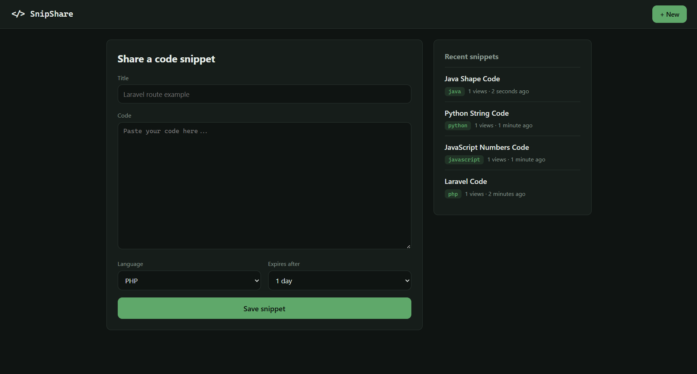
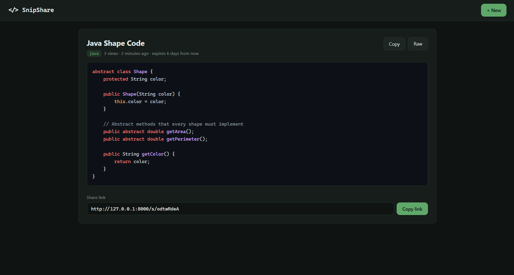

# SnipShare

A simple code snippet sharing app built with Laravel. Paste your code, pick a language, and get a short link you can send to anyone.

**Live demo:** _coming soon_




## Features

- Create a snippet with a title, code and language
- Get a random, unguessable share link like `/s/aB3xK9`
- Syntax highlighting for 10 languages with highlight.js
- Copy the code or the link with one click
- Raw view at `/s/{slug}/raw` that returns plain text
- Snippets expire after 1, 3 or 7 days
- View counter for each snippet
- Recent snippets list on the home page (expired ones are hidden)
- Expired snippets are deleted automatically every day
- Rate limiting: 10 new snippets per minute for each visitor
- Custom error pages (404, 419, 429, 500)
- Responsive layout that works on mobile
- Feature tests for every route

## Built with

- Laravel 12 and PHP 8.2
- Blade components and layouts
- Eloquent ORM
- MySQL or SQLite
- highlight.js
- Plain CSS

## Routes

| Method | URL | Description |
|---|---|---|
| GET | `/` | Create form and recent snippets |
| POST | `/snippets` | Save a new snippet |
| GET | `/s/{slug}` | Show a snippet |
| GET | `/s/{slug}/raw` | Show a snippet as plain text |

## Run it locally

You need PHP 8.2+ and Composer.

```bash
git clone https://github.com/Ehab-Kherbek/snipshare.git
cd snipshare
composer install
cp .env.example .env
php artisan key:generate
php artisan migrate
php artisan serve
```

Then open http://127.0.0.1:8000.

By default the app uses SQLite. To use MySQL, set `DB_CONNECTION=mysql` and your database details in `.env` before running `php artisan migrate`.

## Running the tests

```bash
php artisan test
```

The tests run on an in-memory SQLite database, so they never touch your real data.

## What I learned

- Designing a table and choosing a slug over the id for public links
- Validating form input and mapping form choices to dates with `match`
- Returning different response types (HTML pages and plain text)
- Reusing markup with Blade components, slots and named slots
- Escaping user content with `{{ }}` to prevent XSS
- Protecting a public form with rate limiting
- Adding an index with a new migration instead of editing an old one
- Cleaning up old records with `Prunable` and the scheduler
- Writing feature tests with PHPUnit
